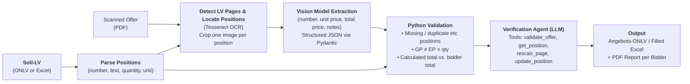

# AI-powered-LV-BOQ-Processing
In this project I implemented an AI-powered workflow for taking BOQs (Bill of Quantities, in German Leistungsverzeichnis LV) that have been filled out by hand and converting them into the Austrian official ONLV format or an Excel file. Reads handwritten digits and extracts the prices using a local vision model, verifies them with a tool-using AI-Agent agent (also local), and writes the result back into a standardized ONLV. ONLV is a specific legally required document format based on XML files. The ONLV can then be imported into different specialized software (mostly Auer Success/Nevaris Success X) to analyze and compare information and prices. Everything runs locally and fully automated, no document leaves the machine.

## Why
In Austrian architecture and engineering offices, bidders often return tenders as printed LVs with prices filled in by hand. This is due to legal regulations regarding the required guidelines of the ÖNORM. Originally it was probably aimed to be a mostly digital process. However, most blue-collar workers/craftspeople and firms handing in the LVs are not using and buying the specialized software for reading and writing ONLV. In this case it leads to the architect sending a digital LV that gets filled out, scanned, and sent back. Meaning the architect has to manually type every comment and price into the program for every offer, just to then again work in the same program he did when sending out the offer-LV. This process takes depending on project size when spending 1 minute per page, with 10 offers with each roughly 40 pages and then 25 different LVs/BOQs around 150 hours. With the automation it takes roughly 5 minutes to check the answers and correct possible mistakes. Cutting human working time to about 15 hours per project.

This tool simplifies that process drastically. However, it should be noted that depending on hardware and use (local or with cloud API), the running time can take multiple hours. The use is quite simple: upload the original LV (Ausschreibungs-LV) and the scanned offers, get back an importable file per bidder plus a PDF report listing everything the software could not resolve with certainty.

## Pipeline in more detail:
Use "streamlit run streamlitapp.py" to start the program

1. Workflow.parse_xml reads an ONLV file (ÖNORM A 2063 XML), and Workflow.excel_LV reads the Nevaris Success X Excel export. Both create a dictionary of each position number with a corresponding custom data structure, saving all important information like the position number, quantity, description, the element in which the data structure is stored, etc.
2. Page analysis. Each page is checked for LV content, ensuring that only pages having a position or other important information are sent to the LLM. For this I use OCR with Tesseract (deu). The coordinates of recognized positions are then stored to put the pages into one image per position, so the vision model only sees a small focused crop. (Tests have shown that the small local models I used are incapable of following the instruction when confronted with a huge amount of positions in one image. Also leading to more errors in order, especially when a position overlaps on the next page.)
3. Extraction. Every rop is sent to a local vision model via Ollam together with the position numbers expected on that page. The response is ensured by Ollama to be a Pydantic JSON schema positionList. Which is afterward edited and combined into one connected pydantic data structure. Also covering possible errors like short position numbers that have been wrongly detected or combining positions split by a page break.
4. Validation. Deterministic Python checks compare the extraction against the target LV and recompute every total price and other metrics.
5. Agent review. The validation is sent to another local LLM that acts as an agent. The agent has four tools enabling him to validate, alter, and rescan pages. It is based around the first principle of verifying data and only then changing a price based on new information. All changes are logged with the agent's reasoning and appear in the PDF report.
6. Output. Depending on the input file, there is either an ONLV created or an Excel file. Both are filled out with all validated prices and, combined with the report, enable the user to validate the workflow outputs quickly.

Ergenisse

## Design decisions, limitations and future possibilities:
- Small local models instead of cloud API. Tender documents are confidential nad should therefore not be uploaded to an cloud API. The small models are not really a design choice and more a hardware limitation on my side. (My laptop runs on 2GB GPU and 8GB RAM) However with bigger models and capabilities the process can not only be made alot faster, but can also be way more reliable. Alot of still occuring errors are limitations of a 4-8 billion parameter model. However I must admit, that there are a lot of differen possible fixes to even further increase accuracy that do not need another model. For example spliting the Unsicherheits parameter in two to account for uncertainties for price and for position making the merging of two positions easier.
- In the future I will probalby implement new functions and feature for the AI Agent. Possibilities here range from new tools to create/delete positions, to also python assurance that changes made by the agent are justified
- Global state in Workflow.py. The agents tool functions operate on module-level variables so the model does not have to pass state around in tool arguments. However this brings a few difficulties when trying to run the program from one PC when two people try to access it at once.
- A possible future feature would be using the position_sources variable to make a quick overview in streamlit, where a human in the loop could validate positions that are unsure. Showing the position and a field for the new value in the app. And moving to the next flawed position afterwards.

